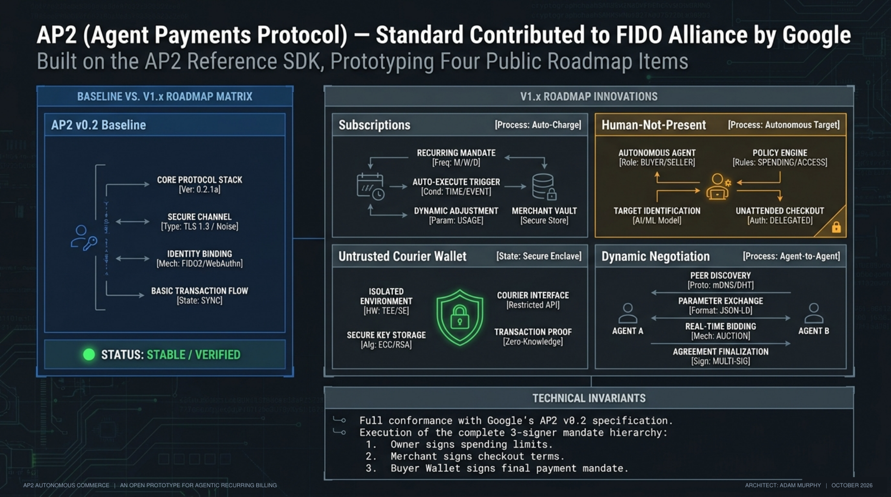
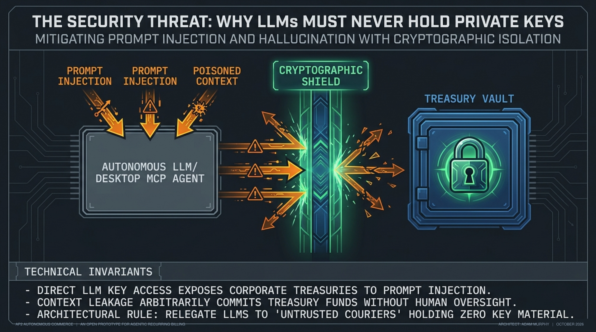
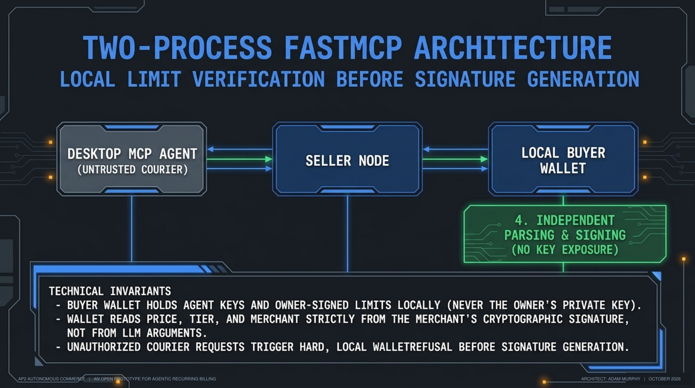
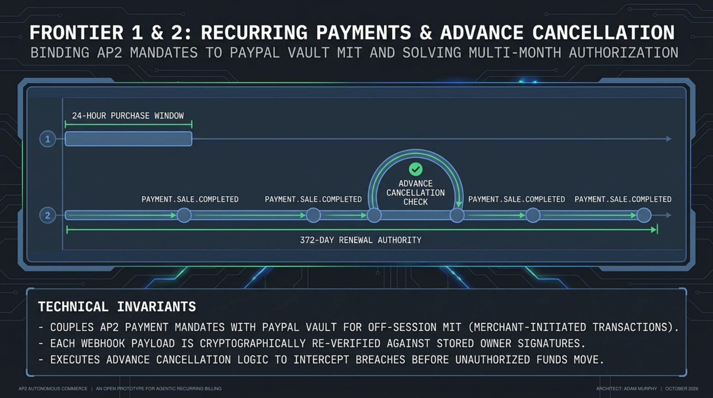
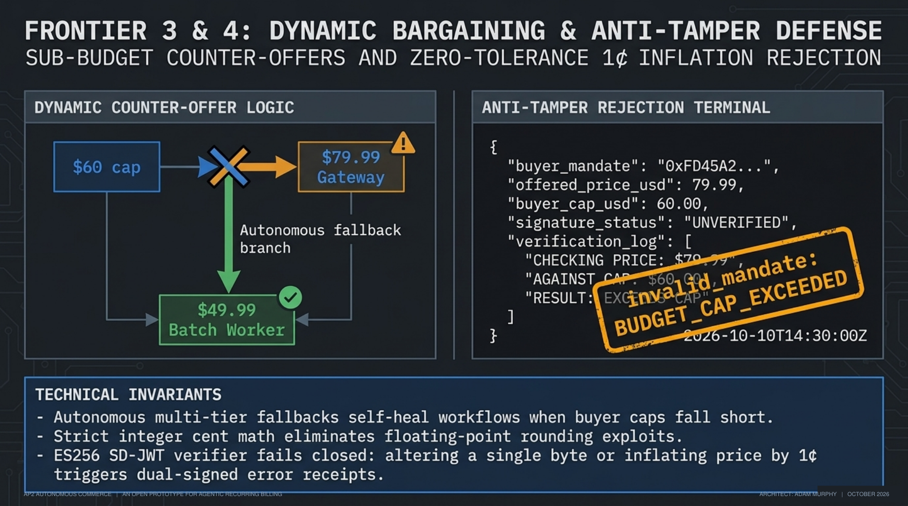
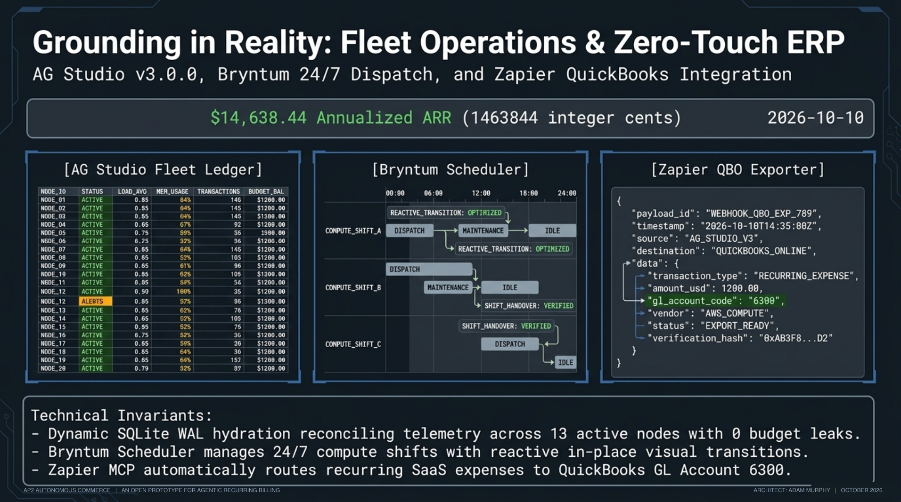
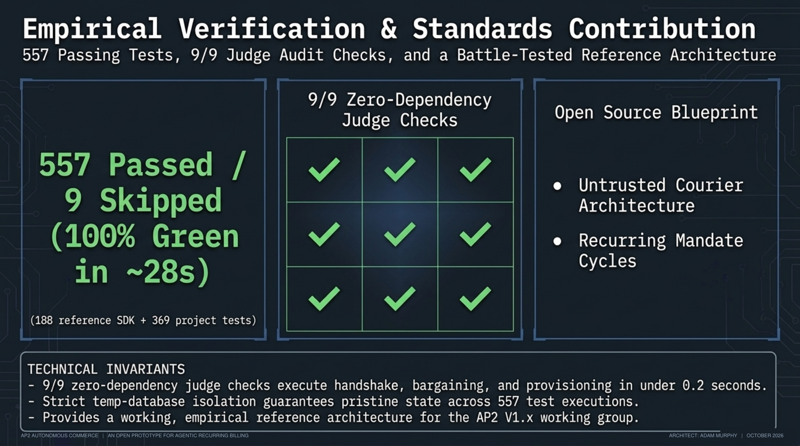
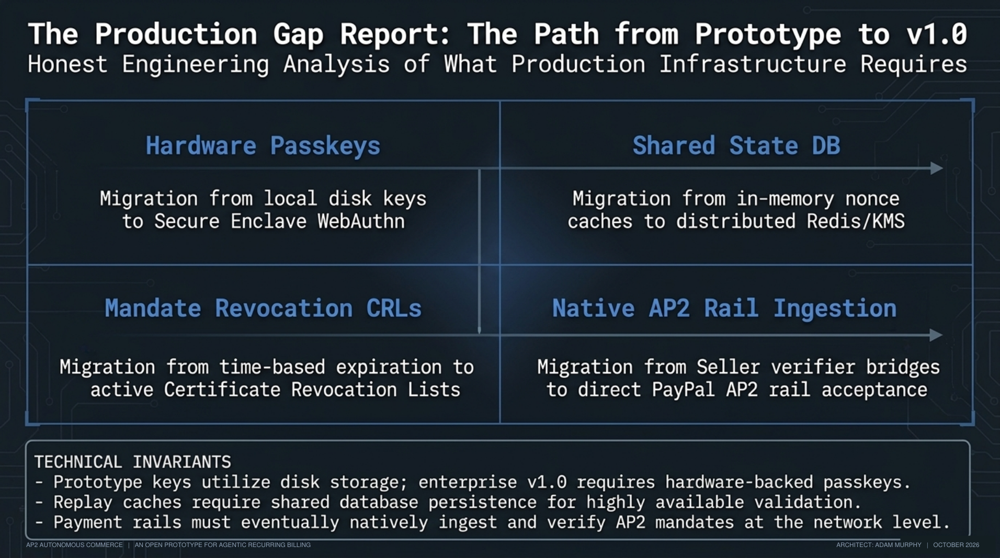

# AP2 Autonomous Commerce &mdash; Devpost Hackathon Submission Docket

> **Event:** PayPal AI Hackathon 2026
> **Key Technologies & Integrations:**
> - **PayPal Subscriptions & Agent Toolkit:** Recurring subscriptions bought by an AI agent under owner-signed AP2 limits, webhook verification, and renewal enforcement
> - **AG Studio v3.0.0 & AG Grid Community:** Fleet ledger with floating column filters and View / Edit modes
> - **Bryntum Scheduler:** Compute dispatch calendar with status transitions
> - **Back-office export:** QuickBooks Online and calendar payloads, ready for a Zapier catch hook
> - **APIMatic:** OpenAPI 3.1.0 specification and SDK generation configuration

---

## 1. Project Title & Tagline

* **Project Title:** AP2 Autonomous Commerce &mdash; Agent Payments Protocol Operations Deck
* **Elevator Pitch (Tagline):** An AI agent buys and renews cloud compute on its own, under spending limits its owner signs with AP2, while the keys stay in a separate wallet the LLM can't touch. Built on AP2 v0.2, the protocol Google donated to the FIDO Alliance, and extending it toward recurring subscriptions, MCP wallets and agent-to-agent negotiation.
* **Interactive Operations Deck:** `/portal/`
* **Seller MCP Server:** `/mcp` (MCP 2024-11-05, JSON-RPC 2.0) and stdio (`backend.mcp_server`)
* **Buyer Wallet MCP Server:** stdio, JSON-RPC 2.0 (`backend.wallet.mcp_server`)
* **Live SSE Stream Endpoint:** `/sse` (Server-Sent Events)
* **Interactive OpenAPI Docs:** `/docs` (Swagger UI)

---

## 2. Inspiration & The AP2 Roadmap



AP2 (Agent Payments Protocol) is the open protocol Google created for agent payments and donated to the FIDO Alliance in April 2026. AP2 v0.2 defines open and closed Checkout and Payment Mandates as SD-JWTs signed with ES256, including a Human Not Present flow where an agent buys on its own under limits the owner signed in advance.

v0.2 stops short of several items on AP2's original roadmap. This project implements v0.2 with Google's own SDK and extends it toward them:

| AP2 item | Where it stands in AP2 | What this project does |
| :--- | :--- | :--- |
| **Recurring payments & subscriptions** | V1.x roadmap item. v0.2 has an `AgentRecurrence` constraint but no standard renewal flow. | Monthly PayPal Subscriptions; every renewal webhook is re-checked against the owner's mandate, with advance cancellation |
| **Human Not Present purchases** | Shipped in v0.2 | Implemented: a desktop AI agent buys under owner-signed open mandates |
| **MCP-based implementations** | V1.x roadmap item | Two MCP servers: the seller, and a buyer wallet that keeps keys out of the LLM |
| **Real-time buyer–seller negotiation** | Long-term vision on the original roadmap | The seller counter-offers the best tier within the buyer's stated budget |

When an AI agent buys cloud compute, four problems show up:
1. **The Untrusted Courier Threat:** An LLM that holds signing keys can be steered by text it reads, including the seller's own replies, into payments its owner never approved.
2. **The Recurring Billing Blind Spot:** AP2 v0.2 has no standard for renewals, and PayPal's renewal webhook arrives after the money has moved, so checking the charge then is detection, not enforcement.
3. **Rigid Catalogs:** If the buyer's cap is just below a tier's price, the purchase fails instead of settling on a tier that fits.
4. **Disconnected Back-Office Accounting:** After the purchase, finance teams still record the recurring expense in their accounting system by hand.

---

## 3. What It Does

### 1. Untrusted Courier Architecture (Two MCP Servers)





* **Keys stay out of the LLM:** The AI agent is an **untrusted courier** between the **Buyer Wallet MCP Server** (`backend.wallet.mcp_server`) and the **Seller MCP Server** (`backend.mcp_server`). The two servers never talk to each other; the agent carries the merchant-signed checkout between them.
* **Limits enforced outside the LLM:** The wallet holds the agent's key and the owner-signed limits, never the owner's private key. It verifies the merchant's signature on `checkout_jwt` against the pinned merchant key, reads price, tier and merchant from that signature, and raises `WalletRefusal` before signing if they don't fit the owner's limits.
* **Tested attack:** The agent tells the seller its budget is $200 when the owner signed $60. The seller issues a $79.99 checkout; the wallet refuses with `PAYMENT_CONSTRAINT_VIOLATION` and signs nothing. Verified by launching both servers exactly as the generated Claude Desktop configuration does; not yet run inside the Claude Desktop app itself.

### 2. Renewal Verification & Advance Cancellation



* **AP2-checked renewals:** In `backend/services/recurring_mandate_service.py`, every PayPal `PAYMENT.SALE.COMPLETED` webhook is checked against the owner's stored mandate with Google's AP2 SDK: stored-mandate integrity, registry key, email binding, expiry, budget, the 12-payment limit and the agreed price.
* **Advance cancellation:** After each authorized charge, the server checks whether the next charge would be allowed, and cancels the subscription on PayPal in advance when the payment count, budget or term would run out.
* **After-the-fact cases:** A price change or other out-of-mandate charge is caught after it happens. Violations cancel the subscription, unverifiable charges suspend it, and refunds are manual. Tested in mock mode; not yet run against the PayPal sandbox.
* **Separate windows:** The owner's authorization gives 24 hours to complete the first checkout, while the recurring payment authority lasts 372 days (12 monthly payments).

### 3. Multi-Tier Counter-Offers



* When the buyer's cap is below the price ($60 cap vs the $79.99 Dedicated AI Service Gateway), the seller counter-offers the best tier within budget: *High-Throughput Batch Worker (125 workload tasks/mo) at $49.99/mo*, in a merchant-signed checkout. The wallet signs it only if it fits the owner's limits.

### 4. AP2 Anti-Tamper Checks
* The purchase path verifies ES256 SD-JWT mandate chains with Google's SDK. Raising the price by 1¢ ($79.99 &rarr; $80.00) or changing the payee fails with `invalid_mandate`, and the seller returns two merchant-signed error receipts (checkout and payment). To prevent concurrent checkouts from racing a mandate's budget or creating duplicate subscriptions, verified subscription purchases acquire a SQLite `purchase_leases` row keyed by open payment mandate hash and buyer email before calling PayPal (sending a deterministic `PayPal-Request-Id` derived from `checkout_hash`) and reject overlapping in-flight purchases with `PURCHASE_IN_PROGRESS`.
* A separate interactive anti-tamper playground lets judges edit a signed payload and watch it fail; it uses an Ed25519/HMAC demo signer with demo keys.

### 5. AG Studio v3.0.0 & AG Grid Fleet Ledger



* Operations deck built with `ag-studio-react`, `ag-studio` (v3.0.0) and AG Grid Community, with floating column filters, bar charts and View / Edit modes.
* Reads the fleet from SQLite. The fleet is **seeded demo data**: 14 subscriptions, 13 active, $1,219.87 MRR and $14,638.44 ARR, labelled as demo data and not revenue.

### 6. Bryntum Dispatch Scheduler
* Built with the Bryntum Scheduler 7.3.7 trial build: a compute dispatch calendar across regional zones.
* A demo button provisions a node through the backend, and its card changes in place from amber `AWAITING PAYPAL` to green active. The schedule itself is seeded.

### 7. Back-Office Export (Zapier-Ready)
* The `dispatch_zapier_mcp` seller tool builds a QuickBooks Online v3 Purchase payload mapped to General Ledger account 6300 (Software & SaaS) and a calendar payload for node health checks. It validates target URLs against SSRF, signs envelopes with HMAC-SHA256, and posts to a configured webhook such as a Zapier catch hook. Without a webhook URL it's a dry run.

---

## 4. Executive Slide Deck Summary (8 Slides)

| Slide | Title | Core Technical Point | Code Anchor |
| :---: | :--- | :--- | :--- |
| **01** | **AP2 v0.2 Baseline & Roadmap** | AP2 v0.2 (now under the FIDO Alliance) implemented with Google's SDK; Human Not Present implemented; recurring payments, MCP and negotiation extended | `backend/vendor/ap2/`, `backend/tests/conformance/` |
| **02** | **The Untrusted Courier Threat** | Why LLMs must never hold private signing keys | `backend/wallet/wallet.py`, `backend/tests/test_buyer_wallet.py` |
| **03** | **Two-Server MCP Architecture** | The wallet holds the agent key and owner-signed limits (never the owner's private key); overspending is refused before signing | `backend/wallet/mcp_server.py`, `scripts/setup_claude_desktop_demo.py` |
| **04** | **Recurring Billing & Renewal Enforcement** | Webhook re-verification, plus advance cancellation before the payment count, budget or term runs out | `backend/services/recurring_mandate_service.py`, `backend/server.py` |
| **05** | **Counter-Offers & Anti-Tamper** | Counter-offer to the $49.99 Batch Worker; 1¢ inflation rejected with `invalid_mandate` | `backend/services/ap2_service.py`, `backend/wallet/wallet.py` |
| **06** | **Demo Fleet Operations (Seeded Data)** | AG Studio v3.0.0 (`EnterpriseFleetLedger.tsx`), Bryntum Scheduler and QuickBooks GL 6300 payloads over seeded demo data | `src/components/EnterpriseFleetLedger.tsx`, `backend/services/backoffice/qbo_exporter.py` |
| **07** | **The Production Gap Report** | Disk keys, in-memory replay caches, no revocation, no native AP2 rail, renewal edge cases, 22 declared mocks | `backend/services/ap2_keys.py`, `docs/MOCKS.md` |
| **08** | **Empirical Verification** | `690 passed, 9 skipped, 4 warnings in 44.47s` (188 SDK + 502 project); 9/9 judge checks in about a second | `pytest backend/tests/ -q -n 4`, `scripts/judge_audit_harness.py` |

---

## 5. Prize Track Alignment

| Prize | Amount | How AP2 Autonomous Commerce Fits |
| :--- | :--- | :--- |
| **Best Use of Agentic Commerce** (main prize) | **$5,000** | An AI agent negotiates, buys and renews compute under owner-signed AP2 limits; the wallet refuses anything outside them; counter-offers settle on a tier that fits. |
| **Best Use of PayPal + AI** (main prize) | **$5,000** | MCP seller server driven by a desktop AI agent; PayPal Subscriptions, webhook verification and renewal enforcement against the owner's mandate; PayPal Agent Toolkit for live-mode subscription lookups. |
| **AG Grid** (sponsor) | **$5,000 (1st)** | Embedded `ag-studio-react` and `ag-studio` (v3.0.0) with AG Grid Community floating filters, bar charts and runtime View / Edit modes over the fleet ledger. |
| **Bryntum** (sponsor) | **$1,000** | Bryntum Scheduler (trial build) dispatch calendar with in-place status transitions. |
| **APIMatic** (sponsor) | **$1,000 + 6-month subscription** | OpenAPI 3.1.0 specification with 48 paths (51 operations) in `openapi.yaml` and `openapi.json`, `apimatic.json` configured for Python, TypeScript and Go SDKs, and self-service buyer key onboarding (Ed25519 or ES256 keys). |

---

## 6. Verification & One-Click Judge Audit



### One-Click Judge Audit (No API Keys)
Judges can run all 9 checks with one command. It runs in-process against a temporary database in about a second:
```bash
python scripts/judge_audit_harness.py
# 9/9 checks passed
```

### Automated Test Suite
```bash
pip install -r backend/requirements.txt -r backend/requirements-dev.txt
python -m pytest backend/tests -q -n 4
# 792 passed, 9 skipped in ~65s (188 Google AP2 SDK tests, byte-identical to upstream, + 604 project tests;
# the 9 skipped need live services: 4 call the PayPal sandbox, 5 probe a deployed server)
```

### Mock Ledger Check (SDCS Gate L)
```bash
python scripts/check_mocks.py
# docs/MOCKS.md matches the MOCK markers in the code.
```
`docs/MOCKS.md` declares all 22 stand-ins for real behavior, and `backend/tests/test_mocks_ledger.py` fails if the ledger and the code disagree.

---

## 7. The 9 Judge Audit Checks

1. **[CHECK 1] MCP JSON-RPC 2.0 Handshake:** `initialize` and `tools/list` return the 8 registered seller tools.
2. **[CHECK 2] Standard AP2 Negotiation:** The $79.99/mo Service Gateway under a $100 budget cap, with ES256 SD-JWT mandate chains.
3. **[CHECK 3] Sub-Budget Counter-Offer:** A *Batch Worker* ($49.99/mo) counter-offer when the cap is $60.00.
4. **[CHECK 4] Anti-Tamper Verification:** 1¢ price inflation, payee changes and budget breaches rejected by Google's AP2 verifier.
5. **[CHECK 5] Compute Node Provisioning:** Subscription verification and node endpoint allocation (`batch-01`, `gateway-01`, `cluster-01`). Endpoints are placeholders; nothing is provisioned.
6. **[CHECK 6] Back-Office ERP Payloads:** A QuickBooks Online v3 Purchase payload mapped to GL account 6300 (generated, not delivered).
7. **[CHECK 7] Fleet Telemetry Reconciliation:** 14 seeded demo subscriptions (13 active, 1 pending), $1,219.87/mo MRR and $14,638.44 ARR, reconciled to the cent.
8. **[CHECK 8] AG Studio & Bryntum Scheduling:** Loads the 14 seeded nodes from SQLite and checks the compute schedule.
9. **[CHECK 9] Buyer Key Onboarding:** A 300-second single-use challenge, a signed response, key enrollment, and rejection of a forged signature.

---

## 8. What's Simulated & What's Next



**Simulated today (all declared in `docs/MOCKS.md`):** PayPal calls and buyer approval in mock mode, the seeded fleet and schedule, placeholder compute endpoints, back-office dry runs without a webhook URL, and a scripted buyer agent unless an LLM provider is configured.

**What's next:**
- Run renewals against the PayPal sandbox and confirm the subscription ID field in the sale payload.
- Run the wallet flow inside the Claude Desktop app.
- Renew the owner's limits after payment 12 and check the spacing between charges.
- Move keys from disk to hardware-backed storage, move replay caches to a shared store, and add mandate revocation.

---

## 9. Built With

`paypal-subscriptions-api`, `paypal-agent-toolkit`, `paypal-react-sdk`, `google-ap2-sdk`, `model-context-protocol`, `ag-studio-v3`, `ag-grid-community`, `bryntum-scheduler-trial`, `apimatic`, `fastapi`, `python-3.13`, `react-19`, `typescript`, `vite-8`, `sqlite-wal`, `es256-sd-jwt`, `quickbooks-online-v3`, `openapi-3.1`
