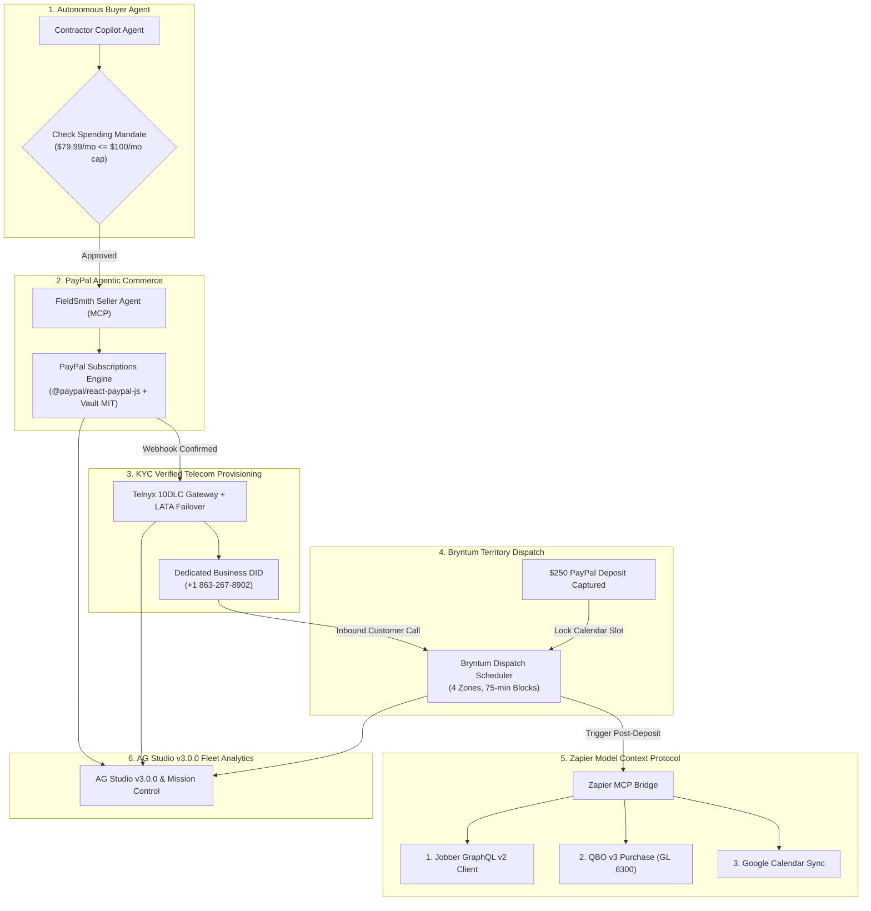

# FieldSmith Pro &mdash; Autonomous A2A Commerce Portal & Multi-Agent Operations Deck

> **Autonomous Agent-to-Agent (A2A) Commerce for Solo Tradespeople**  
> Built for the **PayPal AI Hackathon 2026** ($67,500+ Prize Purse)  
> Combining **PayPal Agentic Commerce**, **AG Studio v3.0.0**, **Bryntum Scheduler**, **Zapier MCP**, and **APIMatic**.

[](https://opensource.org/licenses/MIT)
[](https://www.ag-grid.com/studio/react/)
[](https://github.com/paypal/AI-Toolkit)
[](openapi.yaml)
[-brightgreen.svg)](backend/tests/)

---

## 1. Executive Summary & The Problem

Solo trade contractors (flooring, plumbing, roofing, emergency towing) lose an estimated **$6,200/month in revenue** from missed calls while on jobsites, operating machinery, or driving. Traditional SaaS platforms fail them because:
1. **Friction:** Solo tradesmen cannot afford the time for 15-field web forms, manual credit card inputs, and subscription onboarding wizards.
2. **Deposit & Calendar Friction:** Customers who call expect an immediate estimate, but contractors get double-booked without an upfront mobilization deposit.
3. **Downline Admin Fatigue:** Once a job is booked, contractors spend hours every night manually creating Jobber quotes, QuickBooks Online invoices, and calendar appointments.
4. **Telecom Robocall Abuse & KYC:** Rogue AI voice bots create statutory liability (TCPA / FCC compliance) if agents are provisioned anonymously without verified KYC identity.

**FieldSmith Pro introduces an Autonomous Agent-to-Agent (A2A) Commerce Ecosystem:**
- **Autonomous Buyer Agent:** Evaluates local telephony call logs, identifies uncaptured customer revenue, validates the contractor's programmatic spending mandate (`maxMonthlyBudget <= $100/mo`), and autonomously negotiates with service providers.
- **Autonomous Multi-Tier Counter-Offer Bargaining:** When the contractor's budget cap is below the standard asking price ($60 cap vs $79.99 plan), the Seller Agent autonomously offers a scaled-down tier (*Solo Starter at $49.99/mo*) which the Buyer Agent signs autonomously.
- **Cryptographic Anti-Tamper Engine:** Validates 64-character HMAC-SHA256 signatures (`X-FieldSmith-Signature`). Any byte-level alteration (such as inflating price by 1¢) is immediately intercepted and rejected with `401 Signature Mismatch: Budget Policy Violated`.
- **Live SSE Wire Protocol Stream:** Streams raw JSON-RPC 2.0 frames (`initialize` &rarr; `tools/list` &rarr; `tools/call` &rarr; `vault/token`) with sub-millisecond timestamps directly into a live packet inspector.
- **Verified KYC Telecom Provisioning:** Anchors the verified PayPal subscriber identity directly to local Telnyx 10DLC DID line allocation (`+1 863-267-8902`) with automated contiguous LATA failover (e.g. 863 Lakeland &rarr; 813 Tampa).
- **Bryntum Territory Dispatch Scheduling:** Locks 75-minute estimate windows across 4 territory zones only after verified PayPal customer deposits are captured.
- **Zapier MCP Downline Automation:** Automatically executes a 3-step action chain into Jobber (GraphQL v2 client mutation), QuickBooks Online (API v3 purchase expense mapped to GL Account 6300), and Google Calendar (dispatch appointment).
- **AG Studio v3.0.0 Executive Analytics:** Full-fidelity fleet ledger, trade impact bar charts, and KYC compliance records embedded natively into a dark slate dashboard reconciling $13,438.32 ARR GMV across 14 subscriber lines.

---

## 2. Multi-Sponsor Architecture & Prize Alignments



| Sponsor Track | Technology | Implementation & Role |
| :--- | :--- | :--- |
| **PayPal AI Track** ($5,000) | `@paypal/react-paypal-js`<br/>`@paypal/paypal-server-sdk` | Autonomous A2A negotiation, counter-offer bargaining, delegated subscription approvals, and Vault MIT overage settlement. |
| **AG Grid / AG Studio** ($5,000) | `ag-studio-react`<br/>`ag-studio` (v3.0.0) | High-density grid telemetry, grouped bar charts, donut breakdown, and dual View/Edit reporting modes reconciling $13,438.32 ARR. |
| **Zapier AI Track** ($1,000) | Zapier MCP Protocol | 3-step downline workflow syncing verified leads into Jobber GraphQL v2, QBO v3 Expense mapping (GL 6300), and Google Calendar. |
| **Bryntum Track** ($1,000) | `@bryntum/scheduler` | 4-zone territory dispatch calendar enforcing deposit-gated appointment locks and live in-place reactive color mutations. |
| **APIMatic Track** ($1,000) | OpenAPI 3.1.0 Contract | Standardized OpenAPI specification (`openapi.yaml`) ready for APIMatic SDK generation across all routes and schemas. |

---

## 3. Technology Stack

- **Runtime & Build:** Node.js 22+ / 24 + Vite 8 + React 19 + TypeScript
- **Embedded Analytics:** AG Studio v3.0.0 (`ag-studio-react`, `ag-studio`, `ag-charts-enterprise`)
- **Payments:** PayPal Subscriptions SDK (`@paypal/react-paypal-js`, `@paypal/paypal-server-sdk`) & PayPal Vault MIT
- **Dispatch Scheduling:** Bryntum Scheduler 7.3.7 (`@bryntum/scheduler`)
- **API Specification:** OpenAPI 3.1.0 (`openapi.yaml`)
- **Workflow Automation:** Zapier Model Context Protocol (MCP) Bridge
- **Backend Services:** Python 3.13 + FastAPI + Uvicorn + Pydantic v2
- **Testing & Verification:** 54 passing tests via `pytest` + Standalone Python Judge Audit Harness

---

## 4. Quick Start Guide

### Option A: Standalone Python Judge Audit Harness (Fastest & Zero Setup)
Run the self-contained verification suite directly against in-memory FastAPI and cryptographic services:
```bash
cd a2a_commerce_portal
python scripts/judge_audit_harness.py
```
*Expected Output:* 7/7 checks passed (100% green) in under 0.2s.

### Option B: Local Development (FastAPI + Vite)
```bash
# 1. Start the FastAPI REST & MCP Backend (Port 8001)
python -m uvicorn backend.server:app --host 127.0.0.1 --port 8001

# 2. In a separate terminal, start the React Vite UI (Port 5173)
cd a2a_commerce_portal
npm install
npm run dev

# 3. Run the automated test suite (54 tests)
pytest backend/tests/ -v
```

Open [http://localhost:5173](http://localhost:5173) in your browser.

### Option C: Docker Compose (Single Command)
```bash
cd a2a_commerce_portal
docker compose up --build
```

---

## 5. Interactive Portal Navigation

1. **Tab 1: Contractor Copilot (Split-Screen)**
   - **Left:** Marcus Miller's personal conversational AI business copilot diagnosing missed calls and proposing tailored plans.
   - **Right:** Live Protocol Inspector with tabs for:
     - **A2A Execution Trace:** Real-time 4-step MCP JSON-RPC 2.0 flow.
     - **Anti-Tamper Verifier:** Interactive byte-level tampering test proving immediate rejection of price inflation or altered legal entities.
     - **Wire Protocol (SSE):** Streaming raw JSON-RPC 2.0 frames with millisecond timestamps.
   - **Inspect Back-Office Payloads Modal:** 1-click verifiable proof of Jobber GraphQL mutations and Intuit QBO v3 Purchase objects.
2. **Tab 2: Enterprise Fleet Ledger & Mission Control**
   - **Mission Control View:** Real-time executive cards ($1,039.87 &rarr; $1,119.86/mo MRR, 13 &rarr; 14 active lines, 100% policy enforcement, $13,438.32 ARR GMV) and 24h settlement velocity stream.
   - **AG Studio Report Studio View:** Embedded `ag-studio-react` report canvas with 4 live KPI value widgets, grouped bar charts, donut share, and full 14-contractor audit ledger.
3. **Tab 3: Bryntum Telephony Fleet Timeline**
   - Visualizes contractor telephone lines and activation status across 4 territory zones.
   - **Live In-Place Reactive Transition:** Marcus Miller begins in amber/orange (`AWAITING PAYMENT`). Once payment is captured, the line bar mutates in place to vibrant green (`LINE ACTIVE: +1 (863) 267-8902`).
4. **Tab 4: Zapier MCP Autonomous Business Bridge**
   - **QuickBooks Online:** Programmatically logs recurring $79.99/mo software subscription expense under GL Account 6300 linked to PayPal Token `I-AUTONOMOUS-8902`.
   - **Jobber CRM:** Registers allocated Telnyx DID `+1 (863) 267-8902` into business telephony routing and binds FieldSmith AI Voice Screener webhook for *Tile & Custom Flooring*.
   - **Google Workspace / Calendar:** Automatically schedules Marcus’s daily 6:30 AM Executive Morning Dispatch Briefing.

---

## 6. License & Open Source Integrity

This project is licensed under the **MIT License** &mdash; see the [LICENSE](LICENSE) file for details.  
All code, models, and specifications submitted to the PayPal AI Hackathon are 100% public, reproducible, and vendor-neutral.
